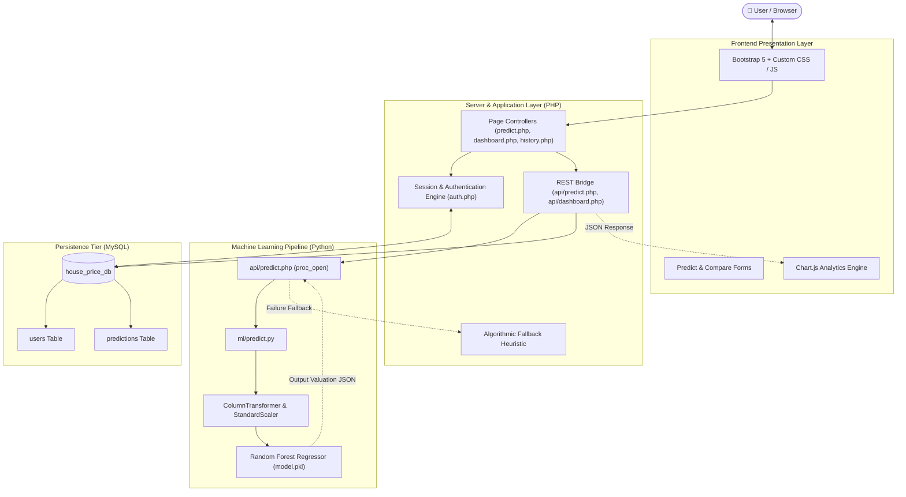

# 🏠 HousePrice AI — Intelligent Real Estate Valuation System

<div align="center">


<p align="center">
  <b>A Full-Stack AI-Powered Real Estate Analytics & House Price Valuation Web Application</b>
</p>

</div>

---

## 👥 Project Team & Contributors

This project was conceived, designed, and developed as a collaborative University **Project-Based Learning (PBL)** initiative:

| # | Member Name | Role & Core Responsibilities |
|---|-------------|------------------------------|
| 1 | **Agnibha Dey** | Project Lead, Full-Stack Architecture, ML Pipeline Integration |
| 2 | **Ranjan Mandal** | Machine Learning Research, Data Engineering & Model Optimization |
| 3 | **Krishna Garai** | Backend Development, Database Schema Design & API Bridging |
| 4 | **Bidyapriya Sahoo** | Frontend UI/UX Engineering, Data Visualizations & Testing |

---

## 📌 Executive Summary

**HousePrice AI** is a state-of-the-art web application developed to bridge the gap between traditional real estate appraisal and algorithmic valuation. By fusing statistical feature engineering with an ensemble **Random Forest Regression** model, the platform delivers instantaneous, high-precision property price estimates across **10+ tier-1 and tier-2 Indian metropolitan markets**.

Unlike static calculators, HousePrice AI analyzes 13 continuous and categorical dimensions—including carpet area, regional sub-locality pricing tiers, age of construction, floor elevation, parking ratios, structural condition, and furnishing levels. The application features user authentication, a rich analytical dashboard with live charting, a side-by-side multi-property comparison matrix, and full prediction history management.

---

## ✨ Key Features & Capabilities

- 🤖 **Ensemble Machine Learning Valuation Engine**:
  - Employs **Random Forest Regression** (`300` estimators) yielding high explanatory power ($R^2 \approx 0.92-0.94$).
  - Dual-layer processing: Predicts dynamic Price-per-Square-Foot ($\text{INR/sq.ft.}$) before synthesizing total valuation.
  - Predicts confidence bounds: Generates fair market value alongside expected **lower bound (-8%)** and **upper bound (+8%)** pricing bands.

- 📊 **Dynamic Analytical Dashboard**:
  - Interactive summary KPI cards: Total Predictions, Portfolio Mean Value, Peak Valuation, and Most Explored City.
  - Real-time visualization powered by **Chart.js**: City-wise valuation distributions, property category breakdowns, and price trends.

- ⚖️ **Side-by-Side Property Comparison (`compare.php`)**:
  - Benchmark two distinct property configurations simultaneously to evaluate valuation differentials, rate per sq.ft., and trade-offs.

- 📜 **Historical Record Tracking & Auditing (`history.php`)**:
  - Persistent, per-user prediction logs stored in MySQL with timestamped snapshots, searchable tables, and deletion controls.

- 🏙️ **Multi-Tier Regional Granularity**:
  - Fine-grained coverage across major Indian cities and prime localities:
    - **Mumbai** (Bandra, Juhu, Worli, Lower Parel, Andheri, Powai, etc.)
    - **Delhi** (Defence Colony, Greater Kailash, Vasant Kunj, Saket, Dwarka, etc.)
    - **Bangalore** (Indiranagar, Koramangala, HSR Layout, Whitefield, etc.)
    - **Hyderabad** (Banjara Hills, Jubilee Hills, Hitec City, Gachibowli, etc.)
    - **Chennai, Pune, Kolkata, Ahmedabad, Jaipur, Surat, Lucknow**

- 🛡️ **Enterprise Security Standards**:
  - Password hashing utilizing `bcrypt` (cost factor 12).
  - Robust PDO prepared statements eliminating SQL injection vulnerabilities.
  - Sanitized input validation and XSS prevention with `htmlspecialchars()`.
  - Secure PHP-to-Python execution through safe `proc_open()` process pipelines.
  - Fail-safe algorithmic fallback: Built-in benchmark mathematical model if Python subsystem is offline.

---

## 🏛️ System Architecture & Workflow



---

## 🧠 Machine Learning Methodology

### 1. Feature Representation

| Feature Name | Type | Description |
|--------------|------|-------------|
| `city` | Categorical | Target metropolis (e.g., Mumbai, Kolkata, Bangalore) |
| `location` | Categorical | High-density locality/neighborhood within city |
| `property_type`| Categorical | Apartment, Villa, Independent House, Studio, Commercial |
| `furnishing` | Categorical | Unfurnished, Semi-Furnished, Furnished |
| `condition` | Categorical | Poor, Average, Good, Excellent |
| `area` | Numerical | Carpet area measured in square feet ($100 - 50,000 \text{ sq.ft.}$) |
| `bedrooms` | Numerical | Bedroom count ($0 - 10$) |
| `bathrooms` | Numerical | Bathroom count ($1 - 10$) |
| `floors` | Numerical | Elevation / total floor level ($1 - 20$) |
| `property_age`| Numerical | Age since construction completion ($0 - 100 \text{ years}$) |
| `parking` | Numerical | Designated parking spaces ($0 - 10$) |
| `total_rooms` | Engineered | Derived as $\text{bedrooms} + \text{bathrooms}$ |
| `area_per_bedroom` | Engineered | Derived as $\frac{\text{area}}{\max(\text{bedrooms}, 1)}$ |

### 2. Model Training & Evaluation Metrics

The model is trained via Scikit-Learn using an end-to-end `Pipeline` combining `OneHotEncoder(handle_unknown='ignore')`, `StandardScaler`, and `RandomForestRegressor`:

```
Algorithm        : Random Forest Regression
Estimators       : 300 Trees
Max Depth        : None (Optimized criterion: squared error)
Coefficient of Determination (R²): ~0.92 – 0.94
Mean Absolute Error (MAE)        : ~₹2,84,000
Root Mean Squared Error (RMSE)   : ~₹5,41,000
```

---

## 📁 Repository Directory Structure

```
House-Price-Prediction/
│
├── api/                            # Backend API endpoints
│   ├── dashboard.php               # JSON feed for chart visualizations
│   └── predict.php                 # PHP-Python execution bridge & fallback
│
├── assets/                         # Static web assets
│   ├── css/
│   │   └── style.css               # Premium dark/light themes & styling
│   └── js/
│       └── script.js               # Client validation, AJAX hooks & UI logic
│
├── database/                       # Database initialization
│   └── house_price_db.sql          # SQL schema, relational constraints & demo seed
│
├── includes/                       # Reusable PHP modular components
│   ├── auth.php                    # Session security & access control guards
│   ├── db.php                      # PDO MySQL database singleton connection
│   ├── footer.php                  # Global HTML footer & script imports
│   ├── header.php                  # Global navbar & meta tags
│   └── sidebar.php                 # Navigation drawer for dashboard views
│
├── ml/                             # Machine Learning module
│   ├── dataset.csv                 # Calibrated multi-city property dataset
│   ├── generate_dataset.py         # Dataset generator & market simulator
│   ├── model.pkl                   # Serialized Random Forest model artifact
│   ├── predict.py                  # Standalone CLI & JSON predictor script
│   ├── requirements.txt            # Python environment specifications
│   └── train_model.py              # Training, evaluation & serialization pipeline
│
├── .gitignore                      # Git exclusion rules
├── about.php                       # Project overview, methodology & team credits
├── compare.php                     # Multi-property comparative analytics
├── dashboard.php                   # Metric summaries & Chart.js data dashboards
├── history.php                     # Log of past valuations with filter/delete
├── index.php                       # Application landing page
├── login.php                       # Secure user authentication portal
├── logout.php                      # Session invalidation & termination
├── predict.php                     # Primary interactive prediction interface
├── register.php                    # User registration & credential hashing
└── README.md                       # Academic & technical documentation
```

---

## 🚀 Setup & Installation Guide

### Prerequisites
- **XAMPP / WAMP / LAMP** (PHP 8.0+ and MySQL 5.7+)
- **Python 3.8+** (with `pip`)
- **Git**

---

### Step 1: Clone Repository

Clone the project directly into your web server's public root (`htdocs` for XAMPP):

```bash
cd C:\xampp\htdocs
git clone https://github.com/Agni207/House-Price-Prediction.git house-price-prediction
cd house-price-prediction
```

---

### Step 2: Database Setup

1. Launch **XAMPP Control Panel** and start **Apache** and **MySQL**.
2. Open your browser and navigate to [http://localhost/phpmyadmin/](http://localhost/phpmyadmin/).
3. Click on the **Import** tab.
4. Browse to and select `database/house_price_db.sql` located inside the project directory.
5. Click **Go** (or **Import**) to create the `house_price_db` schema and tables.

> **Note**: Database connection parameters are configured in `includes/db.php`:
> ```php
> define('DB_HOST', '127.0.0.1');
> define('DB_NAME', 'house_price_db');
> define('DB_USER', 'root');
> define('DB_PASS', ''); // Set your MySQL password if configured
> ```

---

### Step 3: Configure Python Environment

Install the necessary scientific Python packages:

```bash
# Navigate to the machine learning directory
cd ml

# Install dependencies
pip install -r requirements.txt
```

Verify your Python installation:
```bash
python --version
```

---

### Step 4: Verify or Re-Train the ML Model

A pre-trained `model.pkl` is included in the repository. You can verify or regenerate the model anytime:

```bash
python train_model.py
```

Expected training output:
```text
[1/5] Loading dataset ...
      Loaded 120 rows, 11 columns.
[2/5] Cleaning data ...
      Valid records: 120.
[3/5] Engineering features ...
      Train: 102 | Test: 18
[4/5] Training Random Forest Regressor Pipeline (300 estimators) ...
[5/5] Evaluating performance ...
      Test MAE  : ₹2,84,312.00
      Test RMSE : ₹5,41,987.00
      Test R²   : 0.9207
[✓] Model successfully serialized to: model.pkl
```

---

### Step 5: Launch the Application

Access the application in your browser:

```
http://localhost/house-price-prediction/
```

#### Demo User Credentials
For quick examination during review or viva, a seeded demo account is ready:
- **Email**: `demo@houseprice.ai`
- **Password**: `Demo@1234`

*(Alternatively, register a new account on `register.php`)*

---

## 🖥️ Application Demonstration

### 1. Landing Portal (`index.php`)
The entry point features key real-estate statistics, an outline of algorithmic features, and rapid navigation into prediction workflows.

### 2. User Authentication (`login.php` / `register.php`)
Enforces secure credentials storage using `password_hash()` and session management.

### 3. Valuation Form (`predict.php`)
Interactive parameter selection:
- Select from 10 Indian Metros; the system automatically populates popular real estate micro-markets.
- Enter exact area, bedroom/bathroom configurations, age, parking, condition, and furnishing.
- Submits asynchronous request via AJAX to `api/predict.php`.

### 4. Prediction Results & Confidence Interval
- Displays primary estimated market value formatted in standard Indian numbering format (Lakhs / Crores).
- Displays Lower Bound (-8%) and Upper Bound (+8%) fair market ranges.
- Computes estimated Price per Square Foot.

### 5. Multi-Property Comparison (`compare.php`)
Enables direct contrast of two distinct scenarios (e.g., a 2BHK in Bangalore Whitefield vs. a 3BHK in HSR Layout) to assess value per sq.ft. differences.

### 6. Analytical Dashboard (`dashboard.php`)
Visualizes user metrics, breakdown by property typology (Apartments vs Villas vs Commercial), city representation, and historical progression.

---

## 🛠️ Technology Stack Breakdown

| Layer | Technology | Purpose |
|-------|------------|---------|
| **Frontend** | HTML5, CSS3, JavaScript (ES6) | Responsive user interface & client-side interaction |
| **CSS Framework** | Bootstrap 5.3 + Bootstrap Icons | Modern typography, grid system & responsive cards |
| **Data Visualization** | Chart.js | Dynamic client-side analytics & bar/doughnut charting |
| **Backend** | Core PHP 8.x | Routing, session state, business logic & API layer |
| **Database** | MySQL (via PDO) | Relational persistence, data integrity & user tracking |
| **Machine Learning** | Python 3.10+, Scikit-Learn | Data preprocessing, feature scaling & regression pipeline |
| **Data Manipulation** | Pandas, NumPy | Feature matrix transformation & statistical operations |
| **Model Serialization** | Joblib | Serialization and fast deserialization of `model.pkl` |

---

## 🔮 Future Enhancements

- 📍 **GIS / Geospatial Integration**: Integrate OpenStreetMap / Google Maps API for interactive coordinate and distance-to-metro calculation.
- 📈 **Time-Series Inflation Adjustments**: Incorporate RBI real-estate index metrics for predictive temporal growth forecasts.
- 🏙️ **Extended Regional Expansion**: Expand training dataset across 50+ tier-2 and tier-3 emerging smart cities.
- ⚡ **RESTful Microservice**: Decouple the ML pipeline into a containerized FastAPI / Docker microservice.

---

## 📄 Academic Disclaimer & License

This project was developed solely for academic demonstration, evaluation, and educational purposes as part of university curriculum coursework. The price estimates generated are based on mathematical models and should be considered statistical approximations rather than certified financial or legal appraisals.

---

<div align="center">
  <b>Developed by Agnibha Dey · Ranjan Mandal · Krishna Garai · Bidyapriya Sahoo</b><br>
  Academic Project © 2026
</div>
